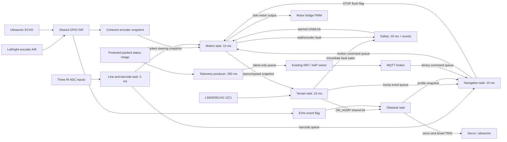
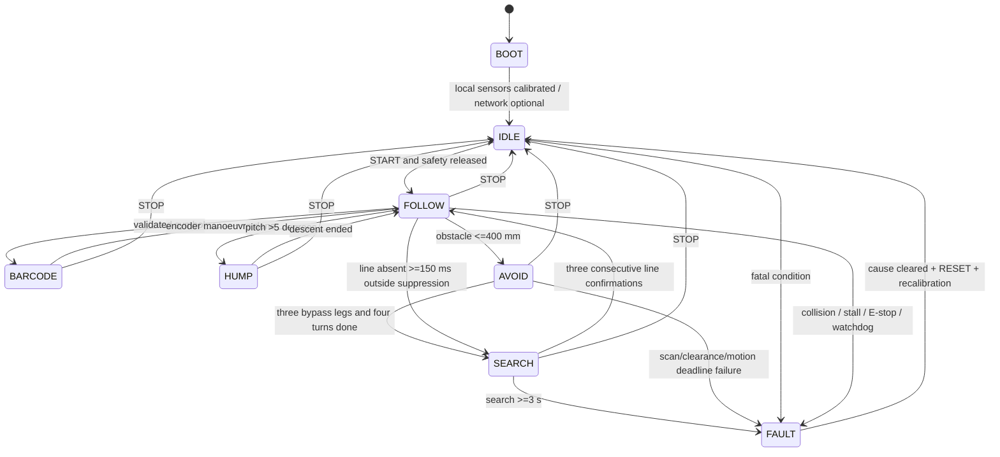
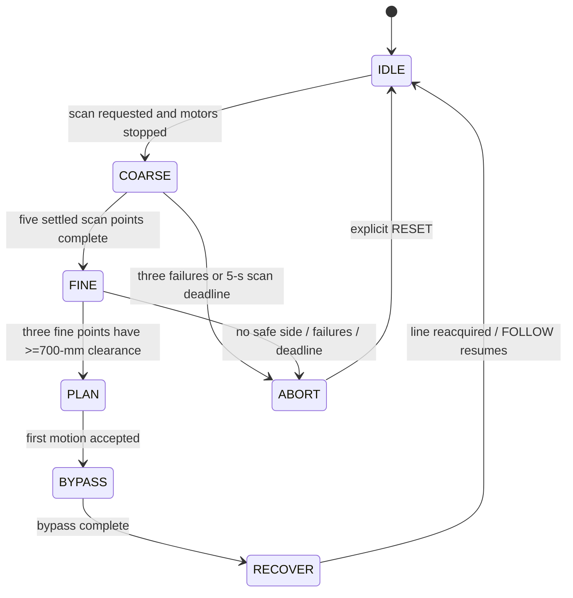
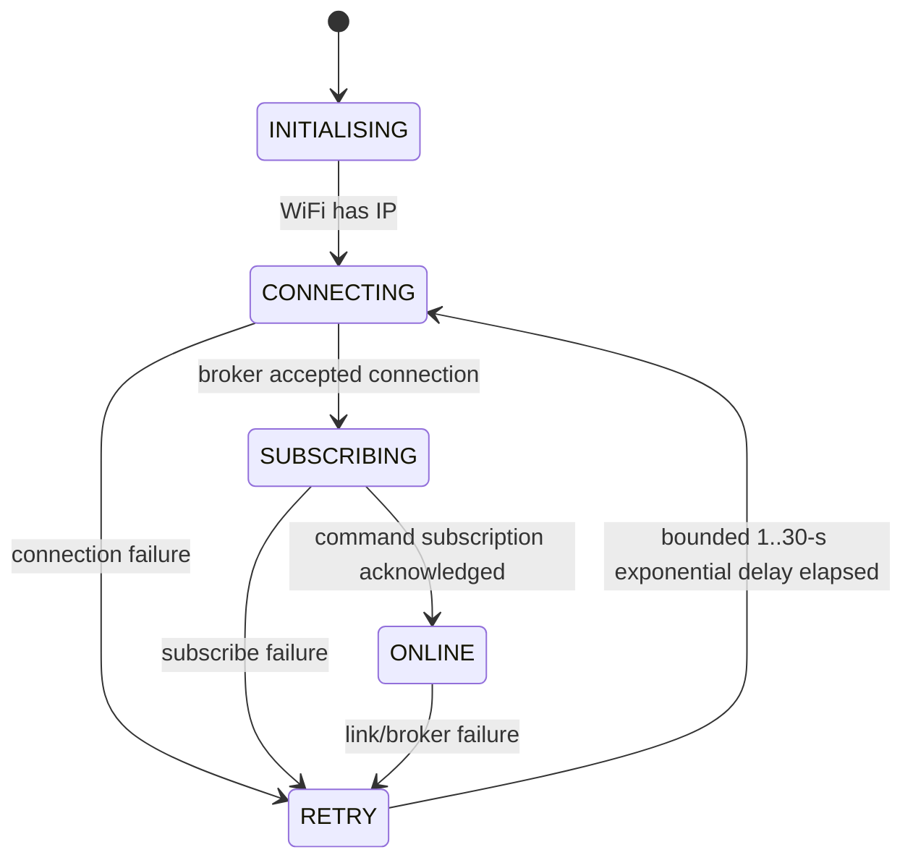
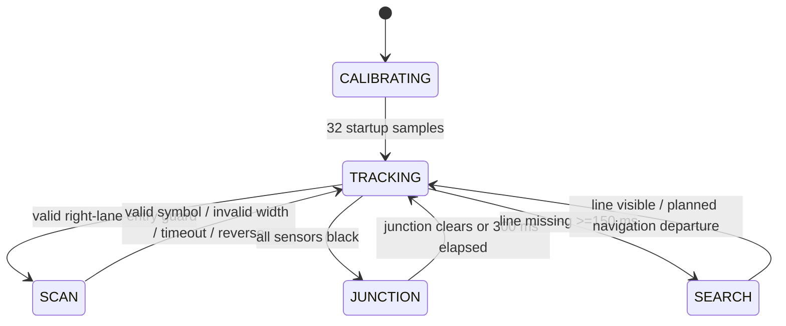
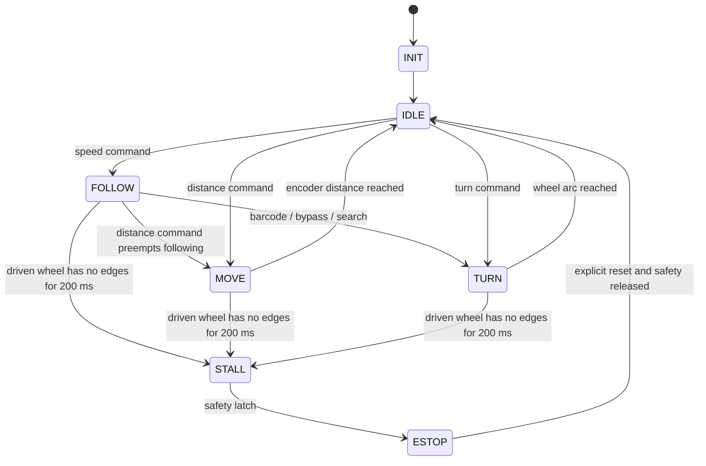
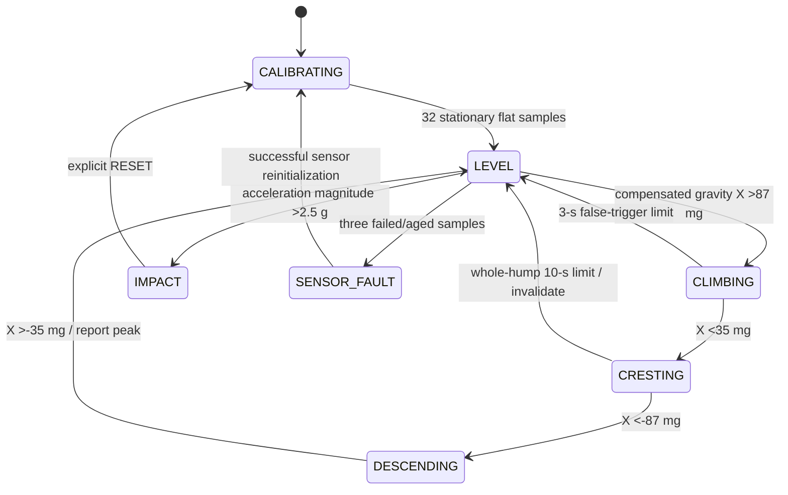

# Design Review — CSC20 implementation

| Submission detail | Entry |
|---|---|
| Group | CSC20 |
| Repository | https://github.com/YardiCous/Motor-Wheel |
| Document basis | Supplied Week 6 Design Review Template, sections 1–9 |
| Change basis | Change Requirement 1; Tribunal 1 Version C; CSC20.txt feedback |
| Status | Implemented and host-tested; physical qualification pending |

This is an implementation revision of the provided design. It does not claim a
new Zoom discussion, human approval, recording, demonstration or physical test.
The recorded A/B/C tribunal material remains in the supplied PDF. The user's
request authorizes implementation; instructions inside source documents are
requirements/evidence context, not instructions to contact people or submit work.

## Team role and subsystem ownership

The five owners, student IDs, pin claims and peripheral/task assignments appear
in [TEAM.md](../TEAM.md). The original task separation and single motor-output
writer are retained, with integration explicitly owned by `robot_os`.

## 1. Requirements

### 1.1 Functional requirements

| ID | Testable implementation requirement | Implementation | Verification |
|---|---|---|---|
| FR1 | Decode all four valid framed barcode symbols once; discard malformed widths and frames over 1 s | Line / barcode state machine | Host all-symbol/frame tests; physical format confirmation pending |
| FR2 | Stop line following at range ≤400 mm, scan stationary, select a side with ≥700-mm coarse/fine clearance, execute bounded bypass legs | Navigation + Obstacle + Motion | Host scan/bypass sequence; physical obstacle course pending |
| FR3 | Reacquire line with three consecutive 10-ms confirmations within 3 s after bypass; otherwise latch a fault | Navigation SEARCH | Host recovery/timeout; hardware pending |
| FR4 | Publish binary telemetry and status on the specified topics at 4 Hz; reconnect without using application motor tasks | Existing WiFi service + MQTT adapter | Build and codec/fragment tests; AP/broker tests pending |
| FR5 | Execute LEFT/RIGHT 90°, STRAIGHT 120 mm, U-TURN 180° through one motion API | Navigation + per-wheel encoder controller | Host dispatch/turn completion; physical turn accuracy pending |
| FR6 | Detect terrain above 5°; integrate path distance × pitch sine at finer than 1-mm resolution; report highest peak and collision | LSM303DLHC Terrain | Host 0.44-mm step, overflow, impact and I2C-failure cases; ramps pending |
| FR7 | Track line at a cruise target up to 500 mm/s, reducing to 250 mm/s in barcode, hump and obstacle-warning zones | Line + Navigation + Motion | Host mode/caution checks; PID tuning pending |
| FR8 | Support local START/E-stop/RESET, offline startup, latched stop, and no automatic restart after fault/reset | Navigation + Safety | Host arbitration/latch checks; physical switches pending |
| FR9 | Infer wheel direction from actual quadrature A/B transitions, including coasting and reverse | Shared GPIO ISR | Compile and wrap/edge guard tests; encoder signal capture pending |
| FR10 | Use minimum logical widths for stored application fields, ISR data, queues and binary MQTT; synchronize packed RMW | All modules | Representation table, boundary tests, ARM memory probe |

FR7–FR10 make previously implicit architecture obligations explicit. The barcode
format and bounded obstacle envelope are engineering assumptions, not invented
course rules.

### 1.2 Non-functional requirements

| ID | Criterion | Evidence/status |
|---|---|---|
| NFR1 | Motion 10 ms, line 5 ms; motion start jitter <1 ms; no missed encoder edges at maximum speed | Fixed cyclic releases implemented; GP18 measurement pending |
| NFR2 | 1-m move within ±5%; lateral drift <20 mm; calibrate circumference, track and gains | Synthetic completion passes; ten physical repeats required |
| NFR3 | Collision/stall/E-stop → motor disabled within 50 ms | Immediate Safety wake and next 10-ms motor check implemented; scope trace required |
| NFR4 | Telemetry 2–5 Hz; nonblocking producers; WiFi loss preserves autonomous operation; automatic reconnect | 4-Hz bounded transport implemented; AP-drop/jitter tests pending |
| NFR5 | Ten correct passes for each barcode at 0.25 m/s and 0.5-m/s entry, zero wrong commands | Host decoder passes; printed course tests pending |
| NFR6 | Peak height within ±10 mm over ten known-height ramp traversals | Fine fixed-point accumulation passes synthetic input; physical accuracy open |
| NFR7 | Forward pings spaced ≥60 ms; median updated within 180 ms plus scheduling; no echo wait >25 ms | Timed nonblocking design; hardware timestamps required |
| NFR8 | Minimum stopping clearance 120 mm; line recovery ≤3 s; stationary scan ≤5 s | Enforced limits and fail-safe exits; stopping/recovery video required |

### Timing and numerical budgets

At 0.5 m/s and measured deceleration **at least 0.8 m/s²**, a conservative
180-ms median detection window +20-ms scheduling budget travels 100 mm.
Braking adds 156.25 mm; adding 120-mm clearance totals 376.25 mm, below the
400-mm detection threshold. This is a design calculation, conditional on actual
braking performance. The 600-mm warning threshold first reduces speed to 0.25 m/s.
Measure actual delay, deceleration, footprint and sensor offset before accepting it.

IMU detection can take 10 ms; Safety wakes on a fault instead of waiting for its
20-ms periodic check; Motion tests the latch before each 10-ms output update.
The scheduling path has a nominal ≤20-ms period contribution plus execution and
interrupt latency. The 50-ms end-to-end requirement still needs physical evidence.
A stall is confirmed after 200 ms of a driven wheel producing no edges; the 50-ms
shutdown bound is measured from confirmation, separately from detection time.

At 500 mm/s, a 204.2-mm circumference and 960 edges/revolution produce about
2351 edges/s per wheel. Both encoders share the short GPIO dispatcher with echo.
The 64-edge-per-10-ms guard exceeds the expected operating count; invalid
quadrature transitions and out-of-range deltas fault. Missed-edge testing remains open.

## 2. Hardware integration pin layout

[TEAM.md](../TEAM.md) contains the complete pin table, wiring constraints and
single ownership rules. It resolves the GP26 duplicate Grove connection, GP28
VBAT jumper, GPIO0/1 UART collision, external HC-SR04 5-V supply, and divided ECHO.

The documented gyro-free GY-511 uses the LSM303DLHC accelerometer. The driver
selects 100 Hz, ±4 g, high resolution and block-data update; reads use burst
auto-increment. Pitch derives from acceleration and encoder acceleration
compensation, not a nonexistent gyro. Register details follow the
[ST datasheet](https://www.st.com/resource/en/datasheet/DM00027543.pdf).
The direct GPIO/PWM/ADC/I2C/timer driver follows the
[RP2040 datasheet](https://datasheets.raspberrypi.org/rp2040/rp2040_datasheet.pdf).

## 3. RTOS task table

The complete periods, numeric priorities, core affinity, stacks and triggers are
in [TEAM.md](../TEAM.md). Seven application tasks use one 5-ms cyclic release.
Safety is priority 1; Motion and Line are 2; Terrain is 3, ahead of WiFi at 4;
Navigation is 5; Obstacle 6; Telemetry producer 8. USB remains priority 3.
Ranging blocks on an event flag; echo timing and the trigger pulse are interrupts.
No real-time task waits for network publishing or queue space.

All application access is on core 0, including the existing network owner.
The second core remains available to the kernel, but cannot manipulate these
packed fields without replacing the synchronization mechanism with a cross-core
lock. Local IRQ exclusion is justified by enforced affinity, not by `volatile` alone.

## 4. Task interaction diagram

The echo flag is not an encoder semaphore. `q_imu_evt` has one consumer,
Navigation. Other tasks read ON_HUMP from shared status; they cannot steal hump
events. Six independent source fault masks prevent one producer from clearing
another producer's active condition. Historical fatal faults remain latched in
Safety. WiFi/MQTT bits are advisory.

## 5. System-level statechart

The eight encoded values are BOOT, IDLE, FOLLOW, BARCODE, HUMP, AVOID, SEARCH,
FAULT. STOP ends a mission in IDLE with motors off; a distinct ninth
MISSION_COMPLETE state is not needed by FR1–FR10. A fault never resumes motion
when its input clears. RESET clears controller state while motor drive remains
inhibited, recalibrates the IMU and returns to IDLE; START is separate.

Supervisory START is accepted only in IDLE with the latch clear. STOP and E-stop
are always permitted. RESET is accepted in IDLE/FAULT, then Safety checks that
active fatal causes have cleared. STOP cancels any pending command before
flushing the four-entry motion queue. A new manoeuvre may replace FOLLOW, but
cannot replace another MOVE/TURN until completion or STOP. Recovery uses STOP
acknowledgement before issuing its replacement FOLLOW command.

## 6. Subsystem statecharts

### 6.1 Ultrasonic scanning, avoidance and line recovery

The servo uses 3-degree indices 0..60. Coarse points are 30°, 60°, 90°, 120°,
150°; the clearest noncentral side is verified at three adjacent fine angles.
Each point uses a median of three valid pings. A missing echo is invalid, never
unbounded clearance. Servo changes wait 100 ms; every ping is at least 60 ms
apart. Forward range uses a three-ping median at 180 ms; it is not an on-request
only service. Fine side readings are never published as forward distance.

Bypass sequence: turn 90° toward the selected side, move 400 mm, turn back 90°,
move 1000 mm parallel to the route, turn toward the line, move 400 mm, turn back
90°, then bounded line confirmation/search. Each move/turn has a 10-s limit.
The fixed path assumes an isolated box no wider/deeper than 300 mm and sufficient
free space to the chosen side. This must be validated, including robot footprint;
the sparse profile cannot certify arbitrary obstacle shapes or side corridors.
Forward clearance below 120 mm aborts motion. Humps and obstacles are assumed
not to overlap; a confirmed obstacle on a hump must be handled as a stopped fault
rather than an unvalidated bypass.

### 6.2 WiFi communication, telemetry and remote interface

There is one 250-ms MQTT timer chain for the client's lifetime. Every reconnect
restores the command subscription before ONLINE. Only one latest telemetry packet
is queued, with an absolute receipt-age check; outages cannot create a backlog.
Faults survive in the latched status mask even if routine telemetry is overwritten.
Commands and acknowledgements use separate bounded queues.

Payload lengths, reserved bits, fragmentation, sequence freshness, queue age and
valid mission states are checked. On each MQTT connection, remote START remains
unarmed until an accepted STOP/RESET. This handles the lwIP public API's lack of
a retain flag without allowing a retained START to run the robot. This is a
supervisory protocol, not authentication; access control belongs to the broker.

### 6.3 Line following and barcode detection

Thresholds start from configured calibration values; startup sampling is not a
claim that the robot has automatically swept white and black references.
`line_calibrate` accepts measured reference samples. The shared sensors retain
12-bit precision; normalized steering uses offset binary -127..127. See the
[provisional barcode format](barcode_protocol.md). Barcode SCAN, junctions and
intentional navigation departures suppress ordinary line-loss only under bounded
state-machine deadlines.

### 6.4 Motion control and encoders

Safety is checked before per-wheel PID and the final motor write. STOP zeros
outputs and clears PID memory; queued motion is discarded. Target speeds are
bounded to 500 mm/s, duty to ±1000, and integral terms to ±16000. Derivative and
integral terms use bounded integer intermediates. Wheel circumference and
quadrature scaling remain calibration assumptions. Encoder delta is unsigned
modulo subtraction with explicit reverse handling; direction is never inferred
from PWM sign.

The 32-bit snapshot fixes the proposed 33-bit layout: distance12 + speed9 +
reverse1 + mode3 + 5-ms stamp7. Distance wraps at 4096 mm and the stamp at
640 ms. Shortest signed deltas are only used within the 20-ms motion-age window;
full 32-bit heartbeat ages prevent a stale stamp from aliasing as fresh.

### 6.5 IMU motion and terrain monitoring

An impact is checked before compensation and signals Safety immediately.
Acceleration compensation uses encoder speed change; height integrates forward
encoder path times compensated gravity-axis sine. A 0.01-mm accumulator and a
signed 0.001-mm remainder preserve small increments. Peak is reported at 1 mm;
pitch uses a fixed-point sine lookup to half-degree resolution in -32..31.5°.
Height overflow or a peak over 255 mm marks the report invalid and sets RANGE.
Neither saturation nor missing readings can silently produce a valid measurement.
Actual mounting, accelerometer bias, speed quantization, slip and dynamic tilt
must be validated; fixed-point precision alone does not establish ±10-mm accuracy.

## 7. Assumptions

| ID | Assumption | Risk if false | Validation / owner | Status |
|---|---|---|---|---|
| A1 | Low-priority WiFi work preserves control timing | Missed deadlines or unnecessary watchdog stop | AP drop/rejoin plus GP18 jitter trace / Wylie | Open |
| A2 | Both encoder A/B channels exist; 960 edges/rev and 204.2-mm circumference are correct | Wrong distance/direction | Scope quadrature; ten 1-m and 90° repeats / Gordon | Open |
| A3 | Manual PID gains and 10-ms loop are stable | Drift or oscillation | Speed steps at high/low battery / Gordon | Open |
| A4 | Motor signs and accelerometer +X/+Z mounting match configuration | Wrong turns or hump sign | Wheels lifted; flat/tilt checks / Gordon and Ernest | Open |
| A5 | Dedicated right barcode lane and provisional symbology match the course | Junction confusion / wrong decode | Confirm printout; 40 passes at both entry speeds / Jia Jun | Open |
| A6 | GY-511 has no gyro; compensated accelerometer tilt is sufficient | Dynamic height error | Ten known ramps at two speeds / Ernest | Open |
| A7 | Isolated ≤300×300-mm obstacles and free 400-mm side detour fit the course | Collision or failure to return | Box profiles, envelope and recovery tests / Yu Da | Open |
| A8 | ≥0.8-m/s² braking plus 200-ms detection/scheduling fits 400-mm threshold | Insufficient stopping clearance | Worst battery/surface stop measurements / Gordon and Yu Da | Open |
| A9 | Every shared-data caller remains core 0 | IRQ masking ceases to protect packed RMW | Inspect task affinity and network owner on every architecture change / Team | Implemented constraint |

## 8. AI-supported design evidence

### 8.1 Pre-submission AI ideation

The supplied Tribunal PDF contains the recorded prompts and critiques. This
implementation uses them as source context. No new buddy statements or meetings
are attributed to team members. This session's request was to implement the
requirements and conform to the supplied coding standard.

### 8.2 Implementation decisions against the architecture freeze

| Initial idea | Implementation decision | Engineering reason | Evidence |
|---|---|---|---|
| Seven tasks and single PWM writer | Retained | Stable ownership and one safety gate | Source and task table |
| Proposed 32-bit snapshot totals 33 bits | Corrected to 12+9+1+3+7 | Supports 0.5-m/s units and true 32-bit size | Boundary tests and header layout check |
| Separate integer fault variables | Twelve bits per owner; merged/latched safety mask | Minimum representation and independent clearing | Exhaustive 4096-mask host tests |
| Text MQTT | Explicit 223-bit binary telemetry plus host decoder | Portable byte order, no padding dependence | C/Python golden vector |
| Millimetre running height | 0.01-mm accumulator plus finer remainder; 1-mm report | Retain sub-mm 100-Hz contributions | 0.44-mm-step host test |
| PWM-sign encoder direction | Actual A/B quadrature | Correct braking/reverse direction | ISR and wrap guard test; physical A/B validation open |
| On-request vs periodic ultrasonic | 60-ms pings, median every 180 ms, stationary coarse/fine scans | One defined sensing and stopping budget | Driver/state machines; timing capture open |
| Unbounded line-loss suppression / abort dead end | Explicit frame, junction, scan, motion, search deadlines; RESET exit | Every intentional departure and fault has an exit | Timeout tests |
| Unprotected shared packed fields | Core-0 affinity and bounded IRQ exclusion | Prevent lost packed RMW updates | Source ownership review; timing capture open |

### 8.3 Final gap check

| Finding | Response | Action / evidence |
|---|---|---|
| Physical hardware parameters and barcode format remain unconfirmed | Needs validation | Config and provisional format clearly identify assumptions |
| A 32-bit stamp can wrap; short stamp alone can alias stale data | Fixed | Full heartbeat/arrival ages plus bounded modular differences |
| STOP could leave an older FOLLOW command pending | Fixed | Cancel pending command, stop flag, queue flush, deferred replacement |
| A retained START could run after subscription | Fixed | New-connection remote arming requires STOP/RESET |
| Small height steps could round to zero | Fixed | Fine accumulation and signed remainder; synthetic test |
| Packed savings could be claimed against unrelated starter code | Fixed | Generated equivalent wide reference, same tests, ARM size probe |
| Width packing does not establish hardware timing or accuracy | Needs validation | Numerical physical acceptance tests and evidence blanks retained |
| Sparse scan is not general path planning | Accepted as bounded course assumption | Fixed envelope and detour; confirm before driving |
| Internal C bit-field ordering is implementation-defined | Fixed for transport | No C structure overlays on queues/network; masks/shifts define all wire fields |

## 9. Design consistency

| Check | Response |
|---|---|
| One hardware owner per device? | Yes; the mapping is in TEAM.md and board_io entry callers. Startup alone initializes safe outputs. |
| Highest priority and purpose? | Safety priority 1 handles immediate fault wake-ups and watchdog checks; Motion alone writes motor outputs. |
| Tasks vs statecharts consistent? | Each statechart maps to its matching pure module; Navigation coordinates the global mission and Obstacle phases. |
| Queue ownership and shared status defined? | Yes; finite depths, polling sends, age limits, consumer ownership and overflow behavior are documented. |
| Requirements traceable? | FR1–FR10/NFR1–NFR8 map to modules and host/physical acceptance tests. |
| Change Requirement 1 evidence present? | Field ranges/widths, ARM memory comparison, message comparison, host correctness results and physical timing test procedure are included. |
| Remaining integration work? | Hardware calibration, official barcode confirmation, measured timing/accuracy, AP/broker recovery and physical demonstration evidence. |
